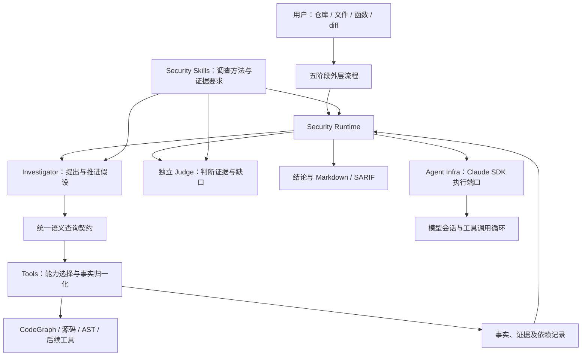

# Security Agent 与 Security Runtime 设计

更新：2026-09-26。本文是当前目标架构的主文档，替代旧版分阶段讨论。
旧文原样保留于 [历史设计](archive/security-agent-before-runtime.md)，不再作为当前实施依据。
术语见 [CONTEXT.md](../CONTEXT.md)，实施顺序见 [MVP 计划](mvp-design.md)。

## 1. 产品目标与范围

建设一个带有专用 Security Runtime 的 Security Agent。用户给出仓库、文件和函数，
Agent 自主发现风险、跨文件追踪来源、检查条件和反例、补充缺失证据，交由独立 Judge 裁决，
输出可核验的结论。Git diff 是另一种目标选择方式；旧 review session 只是可选回归材料。

成功标准包括调查能力与执行可靠性：既能决定下一步查什么，又能中断恢复、控制预算、
说明结论依据及其有效范围。仅跑通一次提示词和报告导出不代表完成目标。

当前聚焦 C/C++、CWE-476、本地运行、独立 Judge、Markdown/SARIF。默认使用 Claude Agent SDK，
按用户后续要求，已扩展本机 OpenCode、Hermes 适配器与按角色选择后端。
保留文件、函数、diff 入口。暂不引入远程 Runtime、Web UI、自动修复。执行后端范围变更见 [Agent Infra 扩展](agent-backends.md)。
Tools 可逐步接入更多代码分析工具，这与增加模型执行后端是两个独立维度。

## 2. 架构与职责



图中 Investigator/Judge 是业务角色，通过执行端口运行，不是另造一个通用模型客户端。
模型发出的查询经 SDK 工具桥接进入 Tools；Runtime 在调用边界检查权限、预算与基线。

| 部分 | 拥有的职责 | 不应承担的职责 |
| --- | --- | --- |
| Security Agent | 提出假设、选择调查方向、解释证据、找反例、提出下一步行动 | 擅自确认 Finding、修改基线或预算 |
| Security Core | 领域对象、规则契约、证据门禁及 Security Runtime | 具体模型协议、某个查询工具的命令格式 |
| Security Runtime | 调查与行动状态、调度、预算、检查点、恢复、Judge 交接、失效传播 | 重写 SDK 的通用模型与工具交互循环 |
| Security Skills | 漏洞调查方法、适用条件、证据要求、停止与补查规则 | 隐含依赖固定工具品牌或宿主会话 |
| Tools | 能力声明、事实查询、工具适配、精度与缺口归一化 | 判断漏洞成立、把候选关系包装成确定数据流 |
| Agent Infra | SDK 会话、消息流、工具桥接、取消及执行结果 | 挑选 CWE、拥有安全状态机或接纳 Finding |

Security Runtime 是 Security Core 内的执行部分，与领域模型同属 Core；不是与 Core 并列的第二套控制中心。
目前代码中的 core/ 与 pipeline/ 共同承载它的初步职责，已实现有界的持续调查初版，准备阶段内恢复等仍待完善。
CLI 组装具体 SDK 和 Tools，Core 只依赖契约。不为了图中每个框新增一个服务或进程。

## 3. 两层循环：调查与通用 Agent 执行

Claude SDK 提供内层循环：模型请求工具 → 工具返回 → 模型继续推理。
Security Runtime 提供外层循环：调查进展 → 检查证据 → 决定继续调查或请求 Judge → 补查或终止。

一次 SDK 调用可以执行多次有界查询。Runtime 不必为每次源码读取重新启动模型；
但每次工具请求与结果都要落盘，阶段性 Hypothesis/Evidence/Missing Fact 通过结构化交接保存。
可恢复状态是这些业务记录，不是模型隐含记忆或私有思维链。

Agent 提议行动，Runtime 校验并执行。首轮允许批量发现多个假设；后续按假设组织补查。
优先补足影响结论的最小事实，例如返回空的条件、实参来源、guard 与 sink 的控制关系。
不预加载完整调用图，不自动扩展用户的 Finding 范围。

## 4. 五阶段仍是外层工作流

| 阶段 | 输入 | 输出与责任 |
| --- | --- | --- |
| pre-process | 用户目标、提交或 diff | 固定基线，定位文件/函数，创建调查单元，绑定索引 |
| preload | 调查单元、基线 | 有界共享上下文、符号与声明、明确的准备缺口 |
| dispatch | 单元、Skill 适用条件、预算 | 单元与规则执行计划；未分配项也要记录原因 |
| review-execute | 执行计划与上下文 | 持续调查、按需查询、证据包、Judge 与再调查 |
| post-process | 调查状态、有效裁决及证据 | 确认项、UNKNOWN、失败与覆盖缺口的报告 |

四个准备/收尾阶段尽量由程序控制；review-execute 内部保留 Agent 的调查自主性。
阶段完成表示完成其契约，不代表源码安全。preload 的局部准备缺口可以带入调查，
但缺失基线或无法定位目标等前置失败不得伪装成可继续的完整输入。

与原 review-skills 的关系：保留五阶段职责、七类查询、CWE 方法和证据思想；
原包的五个独立 Stage Agent 拓扑是轻量 Skill 形态的执行选择，本项目不把它作为强制要求。
相邻包只读、独立分发；本项目通过对应说明和案例验证迁移语义，不建立隐含文件路径依赖。

## 5. 领域对象与状态分离

```text
Run → ReviewUnit → Investigation → Hypothesis
                         ├─ Action / Attempt
                         ├─ MissingFact / QueryResult
                         ├─ EvidenceSet（有版本）
                         └─ JudgeDecision → Finding（仅 CONFIRMED）
```

当前 scenario 对应目标模型的 Hypothesis；现有 investigation 仍偏文件/CWE 单元。
迁移时保留旧 ID 和产物可读性，不在既有 run 中悄悄改变含义。

| 维度 | 建议值与含义 |
| --- | --- |
| Execution | PENDING、RUNNING、COMPLETED、FAILED、TIMED_OUT、INTERRUPTED、BUDGET_EXHAUSTED、STALE |
| Investigation phase | DISCOVER、EXPAND、EVIDENCE_REVIEW、JUDGE、FOLLOW_UP、DONE；描述工作位置 |
| Verdict | CONFIRMED、REJECTED、UNKNOWN；绑定假设及证据版本 |
| Remediation | 当前仅 NOT_STARTED，未来另行设计修复与验证生命周期 |
| Coverage | 独立记录范围、exhaustive 标记与缺口，不压缩成 Verdict |

Hypothesis 至少保存：ID、范围与 sink、可检验主张、证据引用、反例、缺失事实、
已尝试行动、下一步建议、证据版本和最新裁决引用。只保存可审计的简要解释。
Investigation 不提前创建 Finding；FAILED/TIMED_OUT 不自动产生 REJECTED。
当前汇总 Verdict 只是兼容报告视图，不能代替逐假设结论和 Coverage。

## 6. 持续调查与停止规则（已实现初版）

具体实施与限制见 [Runtime 记录](runtime-implementation.md)。以下为目标契约，当前还未实现所有分层预算。

一次典型流程：

1. 发现 sink，建立“某返回值可能为空并被解引用”的假设。
2. 查询定义、返回分支和调用点，保存事实与来源。
3. 若返回行为未知，创建具体 Missing Fact，发起下一轮有界取证。
4. 发现 guard 后寻找其控制作用及反例；不把 guard 的存在等同于有效保护。
5. 证据足够或需要独立检查时，构造版本化证据包送 Judge。
6. Judge 确认、排除，或指出缺失事实。Runtime 决定是否仍有可行的补查行动与预算。
7. 新证据产生新版本；再次裁决。终止时保留全部历史与未解决问题。

目标 Action 契约包含 action_id、hypothesis_id、kind、purpose、输入版本、预算预留、
幂等键和结果引用。首版 kind 只需要 INVESTIGATE、REQUEST_JUDGE、STOP；
具体语义查询仍在有界 SDK 调查会话中执行并独立记账，避免重造通用工具解释器。

允许继续：出现新证据、仍有尚未尝试且支持的查询、Judge 提出可回答的新问题。
必须停止：预算/截止时间耗尽、用户中断、基线失效、没有可执行行动，或持续没有新进展。
对无新输入的重复查询使用规范化指纹去重；重试需记录 transient failure 或输入变化等理由。
设置每假设轮数、Judge 轮数和无进展轮数上限，数值通过验证确定，而非承诺无限自主探索。

UNKNOWN 是有效调查结论。不能为了得到 CONFIRMED/REJECTED 反复询问 Judge，
也不能把“尚有预算”作为无目标继续探索的理由。具体缺失事实与已尝试行动必须可见。

## 7. 独立 Judge 与再调查

Judge 使用独立会话，输入限于 scope、规则、证据包、来源及精度/覆盖限制；
不接收 Investigator 会话、诱导性结论或要求确认的措辞。
使用同一模型的不同会话是上下文隔离，不代表统计独立。

目标 JudgeDecision 包含：hypothesis_id、evidence_version、verdict、evidence_ids、reason、
missing_facts、建议 follow_up。补查是工作流建议，不新增第四种漏洞结论。
Runtime 校验 follow_up 的范围、能力、预算与重复性，并交给 Investigator；Judge 不直接改状态。
新证据使旧 decision 成为历史版本，不能沿用旧确认生成新证据版本的 Finding。

确定性门禁检查来源、引用、版本、scope 和规则要求；Judge 判断空值来源到 sink 的语义可行性。
CWE-476 的 origin/sink/path 引用齐全只是必要条件，不自动证明路径可达。
REJECTED 必须针对明确假设和所述条件；已见调用者非空不证明所有外部调用安全。

## 8. Security Skills 的作用

Skill 是安全调查知识与执行契约：适用条件、调查步骤、反例策略、所需查询能力、
证据要求、交接条件及 UNKNOWN 约定。Runtime 加载并绑定规则版本，SDK 执行其中的推理任务。
无需依赖 Claude Code 自动发现 Skill；当前 skills=[] 与 Core 主动加载规则包并不冲突。

已有 CWE-476 包具备基础契约和角色指令。当前已有结构化 follow_up 与跨轮 missing-fact 投影；更细的反例策略仍需通过案例完善。不要把所有 CWE 的调查过程写成一份固定通用步骤。

## 9. Tools：可演进的代码事实层

Core 使用 find_definition、find_references、find_callers、find_callees、
find_assignments、find_pattern、find_related_symbols，不依赖工具品牌。
Tools 提供能力声明、适用语言/基线条件、原始执行、结果归一化和回退记录。

当前 CodeGraph、Tree-sitter、冻结源码查询共同实现有限能力；未来 Joern、rg、ast-grep、
自研 clang 查询器在同一层接入。仅存在适配接口不等于已支持所有工具或自动路由。
通用语义接口保留后端特有 precision、assumptions、build_config 和诊断，避免抹掉关键差异。

| 结果类型 | 能支持的判断边界 |
| --- | --- |
| text-candidate | 发现文本位置，不能确定符号身份 |
| syntax-observation | 某语法结构存在，不能证明类型、dominance 或可达性 |
| candidate-relation | 图中的候选关联，可能有重载/间接调用歧义 |
| 后续编译语义/数据流事实 | 必须注明分析配置、假设及精度，不能仅凭工具名称升级可信度 |

请求有 purpose、操作、符号/范围、limit、基线身份。结果保存 query_id、status、facts、
coverage、errors、dependencies、producer/version、raw_refs。complete 与 exhaustive 分开。
partial 保留可用事实；error/unsupported 不断言事实。空调用者集合不能证明不存在调用者。
图索引需要完整本地基线视图；送给模型的仍是目标与按需小范围结果。

未来能力选择应先依据能力/精度要求与可用配置，后依据成本；Agent 可建议需要的事实，
不能任意拼接 shell 命令。相互矛盾的事实均保留，由追加取证解决，不静默挑一个工具结果。

## 10. 证据、持久化与恢复

RawOutput → Fact → EvidenceSet → JudgeDecision → Finding，保持可追溯引用。
Evidence 保留精确源码、commit/blob/hash、行范围、查询/attempt、producer、精度与时间；
语义解释另存。追加新版本，不覆盖原始记录。报告只是可重建视图。

目标采用单写入者、原子检查点与追加行动日志，先不引入数据库或完整事件溯源框架。
执行顺序为：持久化行动与预算预留 → 执行 → 保存原始结果 → 校验结果 → 推进业务状态。
恢复优先消费已完成结果；执行结果未知的行动标 INTERRUPTED，重试分配新 attempt，旧预算不退还。
外部模型调用无法保证 exactly-once；通过结果重放减少重复付费，但明确保留未知执行结果。

恢复检查代码基线、规则包、查询工具/索引、输入配置、证据与裁决版本。
当前采取整个 run 失效；后续依赖图可支持局部失效，但须先证明不会漏掉新调用者等负事实变化。
固定提交检视与工作区变化分开；当前不检视未提交代码，不在旧 run 上自动换基线。

准备阶段也需要可恢复的行动记录：clone/index 失败不得留下貌似已完成的 preload。
已实现 snapshot/scope/index/handoff 行动级检查点（M4），索引失败降级并在报告可见。

## 11. 预算与执行约束

目标预算分 Run / Investigation / Action：模型调用与费用预留、工具次数、返回字节、
单次超时与整体截止时间、假设数、调查轮数、Judge 轮数、无进展上限、本地索引/源码资源。
控制层拒绝超额动作；实际消耗和预留分开，未知费用不计为免费。
SDK 报告费用可能不同于兼容 provider 的账单，不承诺精确硬美元上限。

当前已有每次模型调用预算、超时、工具次数/字节、源码快照上限；
已补充全局截止时间、轮数/假设数及无进展控制；Run/Investigation/Action 三层预算
已实现（Investigation 层按调用数与费用预留、Action 层按重试次数），token 级计量待后端统一上报。
源码和工具内容按数据处理，不能改变执行权限。目标代码不执行，默认只读，不自动修复。

## 12. 当前实现与目标差距

| 能力 | 当前状态 |
| --- | --- |
| 新仓库文件/函数与 Git diff 入口 | 已实现，commit-only；diff/整文件仍按文件单元 |
| 五阶段产物与契约 | 已实现初版；准备阶段行动级恢复已落实，契约驱动调度未完整落实 |
| SDK 内模型自主多次查询 | 已实现 |
| 版本化 CWE-476 与证据门禁 | 已实现初版 |
| CodeGraph / AST / 源码查询 | 已实现有限能力；不是完整编译语义分析 |
| Investigator → 独立 Judge → 报告 | 已实现 |
| 持久化假设与跨轮调查 | 已实现初版，按调查轮次轮转 |
| Judge 缺口 → 补查 → 再裁决 | 已实现，受证据变化与预算约束 |
| 单次调用恢复、预算、基线失效 | 已实现；非完整 Security Runtime 生命周期 |
| Run/Investigation/Action 分层预算、准备阶段行动级恢复 | 已实现（M4） |
| 审计交付件（SARIF 自包含、GPG 签名包） | 已实现；VEX/CRA 专用格式仍推迟 |
| 查询复用、能力驱动多工具策略 | 已有同 run 查询复用；策略仍是固定组合 |

现有 138 项测试和 AetherStack 真实调用记录是当前切片的工程验证，不证明准确率/召回率，
后续 Runtime 与多后端验证分别补充记录，不能把工程测试等同于检出质量评估。验证见 [validation.md](validation.md)。

## 13. 设计取舍与验收方向

采用“专用 Security Runtime + 现成 Agent Infra”，兼顾领域控制与 SDK 的交互能力。
全部交给 Skill 会弱化可恢复约束；全部编成固定安全分析步骤又会限制调查选择。
保持单机、一个 CWE 的持续调查闭环；执行端口已用多个宿主验证，进一步扩规则与工具仍以案例为依据。

验证要回答：能否从函数自主追到跨文件根因；能否找到反例并放弃错误假设；
Judge 能否提出有效缺口并触发补查；中断后是否保留新证据；有限预算下是否准确 UNKNOWN。
在同一组新仓库案例上比较原轻量 Skill 与新 Runtime 的结论、覆盖、查询/调用成本和恢复行为。
用源码与独立标注建立期望，旧模型 verdict 只作对照，不能当唯一真值。
